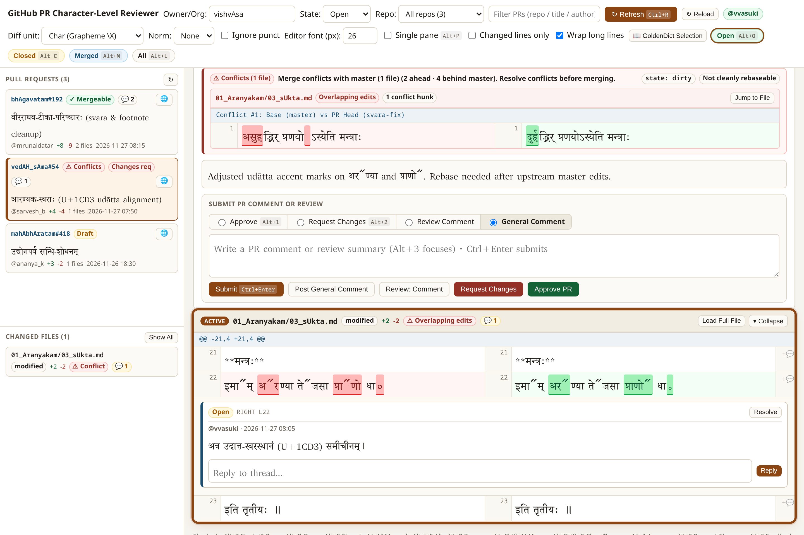

# diff_san

Diff tools tailored for Sanskrit and Indic scholarship (Devanagari, Vedic accents, punctuation-aware proofreading, and multi-repository GitHub review workflows).

## Tools

### [`pull_requests/`](pull_requests/README.md) (`pull_requests_san` on PyPI)

Interactive FastAPI web reviewer for GitHub Pull Requests across an entire organization (default `vishvAsa`) or single repository:

- **Default Single-Pane Word Flow** (`Alt+P` toggles 2-pane LHS/RHS) — matches space-separated strings across line breaks cleanly without failing on blank lines or reflowed paragraphs.
- **Character & Vedic Grapheme Modes** — preserves trailing Vedic accent marks (including `U+1CD3` `᳓`) on grapheme clusters, or switches to raw Unicode codepoints.
- **Unicode Normalization & Punctuation Filtering** — optional `NFC`/`NFD`/`NFKC` normalization and `Ignore punct` (`।`, `॥`, ASCII/Indic punctuation), inspired by [`bhashika-org-in/wordiff`](https://github.com/bhashika-org-in/wordiff).
- **Full PR Workflow** — inline comments, line-range comments, thread replies, draft batching, approvals/request-changes reviews, resolve/unresolve threads, mergeability & 3-way merge conflict diff inspection, open in main browser (`Alt+B`), merge PR (`Alt+Shift+M`), close/reopen PR (`Alt+Shift+C`).
- **Scholarship Typography & Local Helpers** — uses the `Adishila SanVedic` Devanagari font stack, GoldenDict lookup, and IntelliJ IDEA jump-to-line support.

```bash
pip install pull_requests_san
pull_requests_san --owner vishvAsa --state open
```

#### Screenshots

**Single-pane word-flow diff (`Word` mode, default) with Devanagari typography & inline threads:**


**Multi-repo PR dashboard, mergeability check, review composer & action shortcuts:**


**2-pane LHS/RHS Vedic grapheme (`\X`) diff with 3-way merge conflict inspection:**



## Acknowledgements

- [`bhashika-org-in/wordiff`](https://github.com/bhashika-org-in/wordiff) for Unicode normalization, punctuation-ignoring comparison keys, and whole-block inline diffing ideas.
