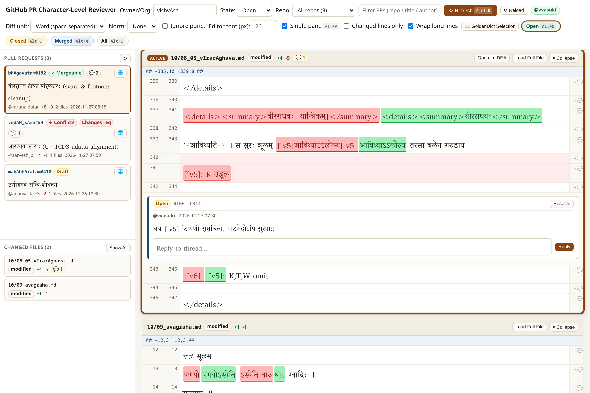
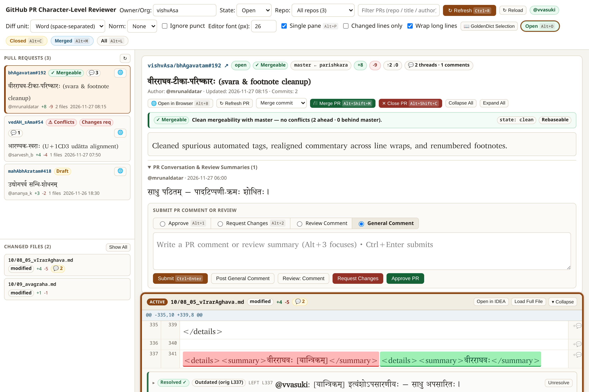
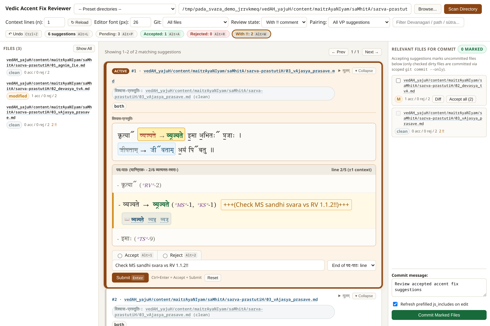
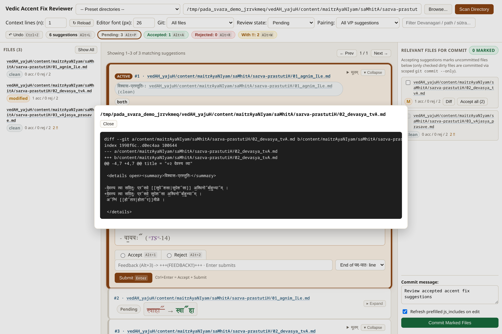

# diff_san

Diff tools tailored for Sanskrit and Indic scholarship (Devanagari, Vedic accents, punctuation-aware proofreading, and multi-repository GitHub review workflows).

## Tools

### [`pull_requests/`](pull_requests/README.md) (`pull_requests_san` on PyPI)

Interactive FastAPI web reviewer for GitHub Pull Requests across an entire organization (default `vishvAsa`) or single repository:

- **Default Single-Pane Word Flow** (`Alt+S` toggles 2-pane LHS/RHS) — matches space-separated strings across line breaks cleanly without failing on blank lines or reflowed paragraphs.
- **Character & Vedic Grapheme Modes** — preserves trailing Vedic accent marks (including `U+1CD3` `᳓`) on grapheme clusters, or switches to raw Unicode codepoints.
- **Unicode Normalization & Punctuation Filtering** — optional `NFC`/`NFD`/`NFKC` normalization and `Ignore punct` (`।`, `॥`, ASCII/Indic punctuation), inspired by [`bhashika-org-in/wordiff`](https://github.com/bhashika-org-in/wordiff).
- **Custom Theme Settings** — `⚙ Settings` color pickers (persisted across `pull_requests_san` and `local-diff-san`), lighter pastel deletion highlights, yellowish additions, and `Adishila SanVedic` Devanagari font sizing.
- **Full PR Workflow** — inline comments (`Ctrl+Click` any hunk line or click `+💬` / line number), line-range comments, expandable collapsed lines above/between/below hunks, thread replies, draft batching, approvals/request-changes reviews, resolve/unresolve threads, mergeability & 3-way merge conflict diff inspection, open in main browser (`Alt+B`), merge PR (`Alt+Shift+M`), close/reopen PR (`Alt+Shift+C`).
- **Scholarship Typography & Local Helpers** — uses the `Adishila SanVedic` Devanagari font stack, GoldenDict lookup, and IntelliJ IDEA jump-to-line support.

```bash
pip install pull_requests_san
pull_requests_san --owner vishvAsa --state open
```

#### Screenshots

**Single-pane word-flow diff (`Word` mode, default) with Devanagari typography & inline threads:**



**Multi-repo PR dashboard, mergeability check, review composer & action shortcuts:**



**2-pane LHS/RHS Vedic grapheme (`\X`) diff with 3-way merge conflict inspection:**


### [`local_diff/`](local_diff/README.md) (`local-diff-san` on PyPI)

Local file and Git `HEAD` diff viewer built on [`pull_requests_san`](pull_requests/README.md) for side-by-side (`Alt+S`) and default single-pane word-flow Sanskrit diffing:

- **Compare a local file or repo against Git `HEAD`** (or `--rev HEAD~1`, branch, or commit), discovering modified, deleted, and untracked files cleanly.
- **Compare two local files directly** with intra-word character highlights, expandable collapsed context lines, Vedic grapheme (`\X`) & codepoint modes, normalization/`Ignore punct`, custom color settings, GoldenDict lookup, and click-to-jump IntelliJ IDEA support.
- **Static website bundle (`docs/index.html`)** — pure-JS `DiffSanEngine` diffs 2 uploaded/dragged files or pasted texts right in the browser with zero server backend (`local-diff-san --export-static docs/index.html`).

```bash
pip install local-diff-san
local-diff-san path/to/file.md              # file vs HEAD
local-diff-san left.md right.md             # 2 local files
local-diff-san                              # all dirty files in repo vs HEAD
local-diff-san --export-static docs/index.html
```

### [`vishvAsa/pada_svara/`](vishvAsa/pada_svara/README.md) (`pada_svara`)

Review UI and corpus scanner for Sanskrit Vedic accent fix suggestions (`[[OLD|NEW]]`) alongside aligned `विश्वास-प्रस्तुतिः`, `मूलम्`, and `पद-पाठः` context across `vishvAsa` repositories:

- **Aligned three-layer context** — displays active/inactive `[[OLD|NEW]]` suggestions in `विश्वास-प्रस्तुतिः`, collapsible `मूलम्`, and `पद-पाठः` provenance bullets (`±n` configurable lines).
- **Dedicated `With !!` feedback queue** — keeps `Pending` focused by separating `+++(...!!)+++` flagged items, with inline feedback editing, undo (`Ctrl+Z`), and rescan (`Ctrl+R`).
- **Typography, lookup & VCS integration** — uses `Adishila SanVedic`, GoldenDict prātipadika lookup chips, IntelliJ IDEA `--line` links, `js_include` prefill sync, and scoped `git diff` / `git commit --only`.

```bash
pip install -e ./vishvAsa/pada_svara
pada_svara --dir /path/to/vedAH_yajuH/content/maitrAyaNIyam/saMhitA/sarva-prastutiH
```

#### Screenshots

**Pending review workspace with collapsed large-font preview & GoldenDict pills:**


**`With !!` feedback filter & inline `पद-पाठः` comments:**



**Scoped Git diff modal after accepting suggestions:**



## IDE Integrations

Launch [`local-diff-san`](local_diff/README.md) directly from IDE context menus (diff selected files/folders against `HEAD`, or compare two selected files):

- **JetBrains IDEs (IntelliJ IDEA, etc.):** [`sanskrit-coders/jetbrains_san`](https://github.com/sanskrit-coders/jetbrains_san) — **Github-san tools** ([JetBrains Marketplace](https://plugins.jetbrains.com/plugin/36520-github-san-tools))
- **VS Code / Open VSX IDEs (VS Code, Cursor, VSCodium, Windsurf, Antigravity):** [`sanskrit-coders/vscode_san`](https://github.com/sanskrit-coders/vscode_san) — **Github-san tools** ([VS Code Marketplace](https://marketplace.visualstudio.com/items?itemName=sanskrit-coders.github-san), [Open VSX](https://open-vsx.org/extension/sanskrit-coders/github-san))

## Acknowledgements

- [`bhashika-org-in/wordiff`](https://github.com/bhashika-org-in/wordiff) for Unicode normalization, punctuation-ignoring comparison keys, and whole-block inline diffing ideas.
