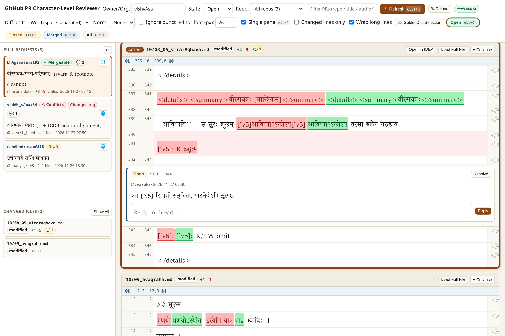
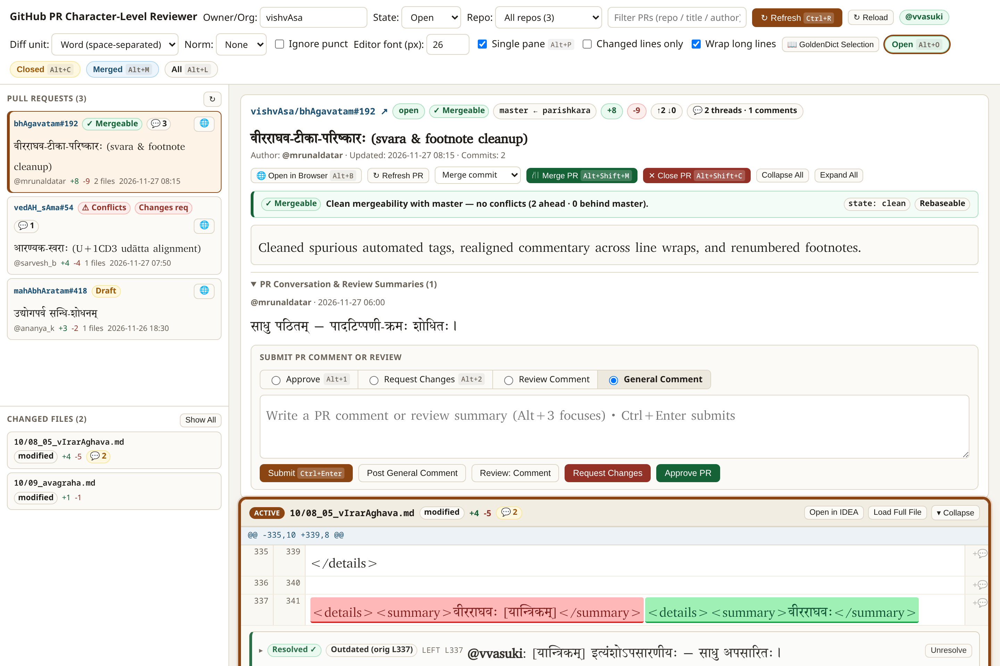
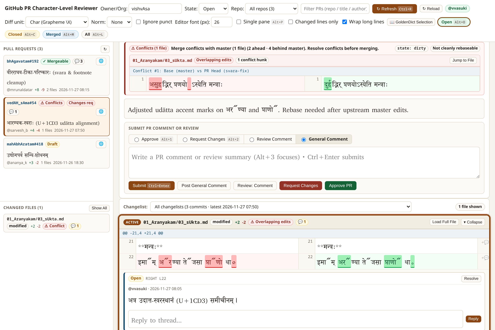

# pull_requests_san

Single-pane word-flow and character/grapheme-level GitHub Pull Request reviewer tailored for Sanskrit and Indic repositories (`vishvAsa` by default, or any `--owner` / `--repo`).

## Install

```bash
pip install pull_requests_san
```

## Usage

```bash
- Live static web app (load any GitHub PR in browser): [sanskrit-coders.github.io/diff_san/pull_requests/](https://sanskrit-coders.github.io/diff_san/pull_requests/)

# Export a standalone static HTML PR reviewer page
pull_requests_san --export-static docs/pull_requests/index.html

# Review all open PRs in vishvAsa repos (or specify any GitHub user/org)
pull_requests_san --owner vishvAsa --state open

# Review a specific repo or use module invocation
python -m pull_requests_san --owner vishvAsa --repo mahAbhAratam
```

GitHub authentication is auto-resolved in order from `--token`, `GITHUB_TOKEN`/`GH_TOKEN`, `~/.config/gh/hosts.yml`, `gh auth token`, or optional `tokens.toml` (`curation_utils.creds` / TOML fallback).

## Key Features

- **Single-pane word-flow diff** (default) matching changed space-separated strings inline without requiring strict line-by-line alignment (`Alt+S` toggles 2-pane LHS/RHS) and highlighting intra-word character differences cleanly.
- **Vedic grapheme & codepoint modes** keeping trailing Vedic svaras (including `U+1CD3` `᳓`) attached to their akṣara.
- **Unicode normalization (`NFC`/`NFD`/`NFKC`) & `Ignore punct`** (`।`, `॥`, quotes, commas) adapted from `bhashika-org-in/wordiff`.
- **Full GitHub review & PR management**: inline line/range comments, thread replies, draft review batching, approve / request changes, resolve threads, mergeability & 3-way conflict inspection, open PR in main browser (`Alt+B`), merge PR (`Alt+Shift+M`), close/reopen PR (`Alt+Shift+C`).

## Screenshots

### Single-Pane Word-Flow Diff (Default)
Matches changed space-separated strings inline across reflowed paragraphs and line breaks cleanly, with Vedic/Devanagari font sizing (`Adishila SanVedic`, 26px) and inline Sanskrit review threads:



### PR Controls, Mergeability & Review Submission
Browse all open PRs across an organization or repo, inspect mergeability status, open PRs in your main browser, approve/request changes, close, or merge:



### 2-Pane Vedic Grapheme Diff & 3-Way Conflict Inspection
Toggle `Alt+S` for 2-pane LHS/RHS mode and `Char (Grapheme \X)` to keep Vedic accent marks (`U+1CD3` `᳓`, etc.) attached to their akṣara, plus inspect 3-way overlapping merge conflicts before resolving or rebasing:


