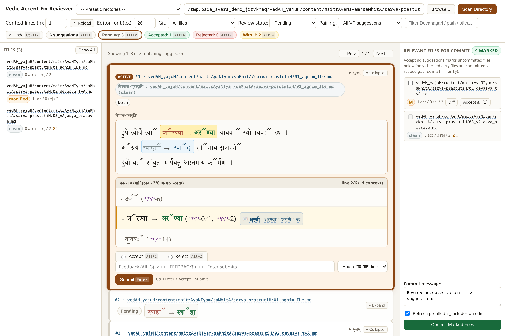
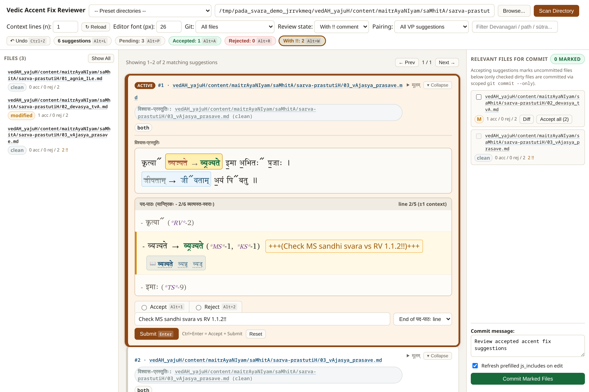
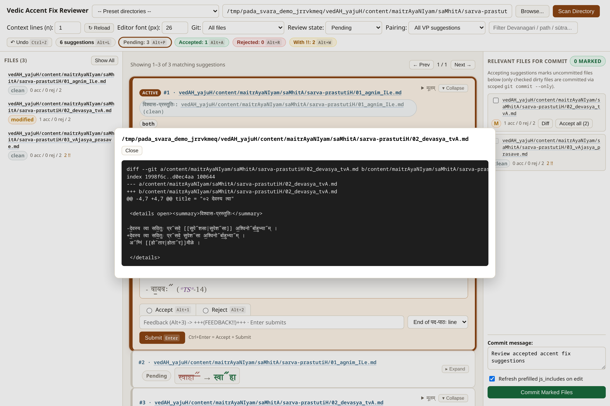

# pada_svara

A FastAPI-backed local web GUI and scanner for reviewing Sanskrit Vedic accent fix suggestions (`[[OLD|NEW]]`) alongside aligned `विश्वास-प्रस्तुतिः`, `मूलम्`, and `पद-पाठः` blocks across `vishvAsa` Markdown corpora.

## Installation

```bash
pip install -e .
```

Or directly from GitHub:

```bash
pip install "git+https://github.com/sanskrit-coders/diff_san.git#subdirectory=vishvAsa/pada_svara"
```

## Usage

```bash
pada_svara --dir /path/to/vedAH_yajuH/content/maitrAyaNIyam/saMhitA/sarva-prastutiH
# or:
python -m pada_svara --dir /path/to/vedAH_yajuH/content/maitrAyaNIyam/saMhitA/sarva-prastutiH
```

Useful options:
- `--dir DIR`: Initial directory to scan for `[[OLD|NEW]]` accent fix suggestions and `+++(...)+++` feedback notes.
- `-n, --context-lines N`: Number of preceding/succeeding `पद-पाठः` lines to display around the target token (default: `3`).
- `--port PORT`: Port to bind on `127.0.0.1` (default: `8765`, advancing to the next free port if busy).
- `--no-browser`: Start the server without auto-opening a browser window.

## Screenshots

### Suggestion Review Overview & Collapsed Large-Font Preview
Aligned `विश्वास-प्रस्तुतिः`, collapsible `मूलम्`, `पद-पाठः (यान्त्रिकः)` context lines, GoldenDict prātipadika lookup pills, and large `--dev-font-size` correction preview on collapsed cards.



### `With !!` Feedback Filter & Inline Corpus Notes
Dedicated `With !!` filter (`Alt+W`) excludes flagged items from `Pending` counts, highlights inline `+++(...!!)+++` comments in `पद-पाठः`, and prefills the feedback editor.



### Scoped Git Diff & Batch Review
Inspect per-file unified git diffs directly from the review workspace before running scoped commits on marked files.



## Features

- **Aligned three-layer context**: Renders `विश्वास-प्रस्तुतिः` with active/inactive `[[OLD|NEW]]` diffs, collapsible `मूलम्`, and paired or embedded `पद-पाठः` provenance bullets (`±n` configurable context lines).
- **Zero-clutter `Pending` queue**: Excludes items carrying `!!` comments from the `Pending` filter (`Alt+U`) into a dedicated `With !!` queue (`Alt+W`).
- **Keyboard-first review**: `Alt+1` (Accept), `Alt+2` (Reject), `Alt+3` (Focus feedback), `Enter` (Submit), `Ctrl+Enter` (Accept + Submit), `←`/`→` (Collapse/Expand card), `Ctrl+Z` (Undo), and `Ctrl+R` (Rescan directory after external edits).
- **Vedic dictionary, Aṣṭādhyāyī & IDE links**: One-click GoldenDict prātipadika/stem lookup chips, automatic `ashtadhyayi.com/sutraani/<a>/<p>/<n>` links for Pāṇini sūtra references (`पा॰ ...` / `पा.सू. ...`, ignoring Vedic verse numbers), and IntelliJ IDEA `--line` navigation for `विश्वास-प्रस्तुतिः`, `पद-पाठः`, and host include files.
- **Prefill sync & scoped git commits**: Propagates edits across nested `<div class="js_include">` host prefills and commits only checked dirty files via `git commit --only`.

## Development & Tests

```bash
pytest -v
```
